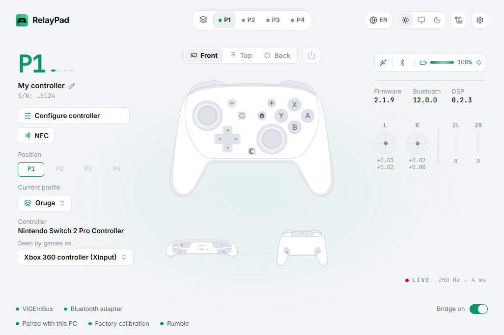

  <picture>
    <source media="(prefers-color-scheme: dark)" srcset="media/lockup-dark-lg.svg" />
    
  </picture>

<h3 align="center">Play any PC game with your Nintendo Switch controller.</h3>

  

  Free · Windows 10 and 11 · Bluetooth or USB · Updates itself 
  <a href="https://elegantcatterpillar.github.io/RelayPad/">Website</a> · <a href="https://elegantcatterpillar.github.io/RelayPad/guide/">User guide</a> · <a href="#support-relaypad">Support</a> · <b>English</b> · <a href="es/README.md">Español (México)</a>

You already own a great controller. RelayPad lets you use it on PC. It connects your Switch 2
Pro Controller, Joy-Con 2 or Switch Pro Controller and shows it to your games as an Xbox 360
or DualShock 4 controller, so every game that supports a gamepad just works: no per-game
setup, no extra tools.

  <picture>
    <source media="(prefers-color-scheme: dark)" srcset="media/screens/en/dark/status.png" />
    
  </picture>

## Why RelayPad

- **Every button, every feature.** Sticks, triggers, the Switch 2 GL, GR and C buttons,
  motion, HD rumble, player LEDs and battery.
- **Wireless or wired, without thinking about it.** Plug in the cable while you play and keep
  going: the game never loses the controller.
- **Play together.** Up to four controllers at once, each on its own player.
- **Make it yours.** Named profiles per controller: remap buttons, turbo, macros, stick
  deadzones and curves, gyro aim, and rumble you can try before you save.
- **NFC and amiibo.** Read amiibo and tags with the character's name, write a text onto a
  blank tag, and [back up your own amiibo](amiibo-backup.md) and write it onto a blank tag. It all
  works on the Switch 2 Pro Controller, the right Joy-Con 2 and the Switch Pro Controller
  (Switch 1).
- **Lives in your tray.** Battery, status and player at a glance, in English or Spanish.
- **Always current.** New versions install themselves when no controller is in use.

## Controllers

✅ works · — the controller has no such hardware

| Controller | Bluetooth | USB | Buttons and sticks | Motion | Rumble | Player LEDs | Battery | NFC |
|---|---|---|---|---|---|---|---|---|
| Switch 2 Pro Controller | ✅ | ✅ | ✅ incl. GL, GR, C | ✅ | ✅ HD | ✅ | ✅ | ✅ read · write · amiibo |
| Joy-Con 2 (L) or (R) | ✅ | — | ✅ held sideways | ✅ | ✅ | ✅ | ✅ | ✅ right one only |
| Joy-Con 2 pair (L + R as one) | ✅ | — | ✅ | ✅ | ✅ | ✅ | ✅ | ✅ with the right one |
| Switch Pro Controller (Switch 1) | ✅ | ✅ | ✅ | ✅ | ✅ HD | ✅ | ✅ | ✅ read · write · amiibo |

**Coming next:** the original Joy-Con (L), (R) and NES Joy-Con. The
[roadmap](ROADMAP.md) has the rest of the Switch family.

**Other systems:** RelayPad runs on Windows today. A Linux version comes next, then macOS.

## Get started in 3 steps

1. **Download** the installer from the
   [latest release](https://github.com/ElegantCatterpillar/RelayPad/releases/latest) and run it.
2. **Install ViGEmBus** when RelayPad asks for it (one click in **Settings → Drivers**).
3. **Connect your controller** over USB or Bluetooth. The main screen shows the steps for your
   model.

That's it: open your game and play. The [user guide](https://elegantcatterpillar.github.io/RelayPad/guide/) covers every
controller, profiles, amiibo and troubleshooting.

**You need:** Windows 10 or 11 (x64) and a Bluetooth adapter or a USB cable.

## Questions

**Is it free?**
Yes. RelayPad is free for personal use. See [LICENSE](LICENSE).

**Windows warns about the installer. Is it safe?**
RelayPad is new and its installer is not code-signed yet, so Windows SmartScreen may show
"unknown publisher". Choose **More info**, then **Run anyway**. Updates are signed, and the app
checks that signature before installing one. Every release lists the installer's SHA-256 and a
VirusTotal scan.

**Which games work?**
Any game that supports an Xbox 360 or DualShock 4 controller, which covers almost every PC game
with gamepad support, on Steam or anywhere else.

**Do I need Bluetooth?**
Not always. The Switch 2 Pro Controller and the Switch Pro Controller work over a USB cable.
Joy-Con 2 have no USB port, so they need a Bluetooth adapter.

**Can I use several controllers at once?**
Yes, up to four, each on its own player. You can move a controller to another player or swap
two of them from the app.

**Will games see two controllers?**
They can. Install the optional **HidHide** driver from **Settings → Drivers** and games only
see the RelayPad controller (on Switch 2 controllers this is still being tested).

**Does it send my data anywhere?**
No. RelayPad can keep a diagnostic report on your PC if you allow it on first run. Nothing is
uploaded.

**How do I uninstall it?**
From **Settings → Apps → Installed apps** in Windows. The uninstaller removes the app and its
shortcuts, shows again any controller it hid, and can delete its settings, logs and profiles
too. ViGEmBus and HidHide stay installed; remove them first from **Settings → Drivers** in
RelayPad if you no longer want them.

## Help and ideas

Start with [troubleshooting](https://elegantcatterpillar.github.io/RelayPad/guide/#troubleshooting) in the user guide. If RelayPad
closed unexpectedly or logged an error, **Report on GitHub** in the app opens a prefilled
issue with serial numbers and Bluetooth addresses hidden.

Something not working, or a feature you want? [Open an issue](https://github.com/ElegantCatterpillar/RelayPad/issues)
and tell us your controller, your Windows version, and whether you use USB or Bluetooth.

What's new: [changelog](CHANGELOG.md) · What's next: [roadmap](ROADMAP.md)

## Support RelayPad

RelayPad is free and stays free: support is optional and unlocks nothing. It is built by one
developer, and every controller is tested on real hardware before it ships. Support pays for
exactly three things:

- **The controllers still missing,** bought and tested by hand so they work natively in
  RelayPad: the Joy-Con (L) and (R) alone or as a pair, the NES Joy-Con, the Nintendo Switch
  Online GameCube Controller, and the Super Nintendo, Nintendo 64 and SEGA Genesis controllers.
- **Linux, then macOS:** the same controllers on more computers.
- **A driver of its own:** today games see the controller through ViGEmBus and HidHide, two
  drivers from other projects, and ViGEmBus is no longer developed. RelayPad's own driver
  removes that dependency.

[Support RelayPad on Ko-fi](https://ko-fi.com/elegantoscar). A star on this repository and telling a friend help too.

---

RelayPad is an independent project, not affiliated with, endorsed by or sponsored by
Nintendo, Microsoft or Sony. Nintendo Switch is a trademark of Nintendo, Xbox of Microsoft and
DualShock of Sony Interactive Entertainment. Joy-Con and amiibo are trademarks of Nintendo. Third-party notices:
[THIRD_PARTY_LICENSES](THIRD_PARTY_LICENSES). Uses ViGEmBus and, optionally, HidHide, each
under its own license.
