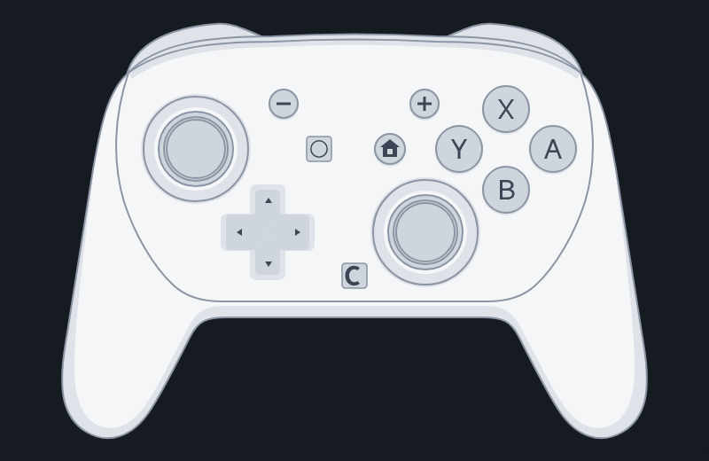

  <picture>
    <source media="(prefers-color-scheme: dark)" srcset="../media/lockup-dark-lg.png" />
    
  </picture>

<h3 align="center">Juega cualquier juego de PC con tu control de Nintendo Switch.</h3>

  

  Gratis · Windows 10 y 11 · Bluetooth o USB · Se actualiza solo 
  <a href="../README.md">English</a> · <b>Español (México)</b>

  

Ya tienes un gran control. RelayPad te deja usarlo en PC. Conecta tu Control Pro de Switch 2,
tus Joy-Con 2 o tu Control Pro de Switch y se lo presenta a tus juegos como un control de
Xbox 360 o DualShock 4, así que cualquier juego compatible con control simplemente funciona:
sin configurar cada juego, sin herramientas extra.

## Por qué RelayPad

- **Todos los botones, todas las funciones.** Sticks, gatillos, los botones GL, GR y C de
  Switch 2, movimiento, vibración HD, LEDs de jugador y batería.
- **Inalámbrico o con cable, sin pensarlo.** Conecta el cable a mitad de la partida y sigue
  jugando: el juego nunca pierde el control.
- **Juega en compañía.** Hasta ocho controles a la vez, cada uno con su jugador.
- **Hazlo tuyo.** Perfiles con nombre por control: reasigna botones, turbo, macros, zonas
  muertas y curvas de los sticks, apuntado con giroscopio y una vibración que puedes probar
  antes de guardar.
- **NFC en el Control Pro de Switch.** Lee amiibo y etiquetas con el nombre del personaje, y
  escribe un texto o un ID de amiibo en una etiqueta en blanco.
- **Vive en tu bandeja.** Batería, estado y jugador de un vistazo, en español o inglés.
- **Siempre al día.** Las versiones nuevas se instalan solas cuando ningún control está en uso.

## Controles

✅ funciona · 🧪 hecho, en pruebas con hardware · — el control no tiene ese hardware

| Control | Bluetooth | USB | Botones y sticks | Movimiento | Vibración | LEDs de jugador | Batería | NFC |
|---|---|---|---|---|---|---|---|---|
| Control Pro de Switch 2 | ✅ | ✅ | ✅ incl. GL, GR, C | ✅ | ✅ HD | ✅ | ✅ | |
| Joy-Con 2 (L) o (R) | ✅ | — | ✅ en horizontal | ✅ | ✅ | ✅ | ✅ | |
| Par de Joy-Con 2 (L + R como uno) | 🧪 | — | 🧪 | 🧪 | 🧪 | 🧪 | 🧪 | |
| Control Pro de Switch (Switch 1) | ✅ | ✅ | ✅ | ✅ | ✅ HD | ✅ | ✅ | ✅ lectura · 🧪 escritura |

**Lo que sigue:** los Joy-Con originales (L), (R) y los Joy-Con de NES. La
[hoja de ruta](ROADMAP.md) tiene el resto de la familia Switch.

## Empieza en 3 pasos

1. **Descarga** el instalador de la
   [versión más reciente](https://github.com/ElegantCatterpillar/RelayPad/releases/latest) y
   ejecútalo.
2. **Instala ViGEmBus** cuando RelayPad te lo pida (un clic en **Ajustes → Controladores**).
3. **Conecta tu control** por USB o Bluetooth. La pantalla principal te muestra los pasos para
   tu modelo.

Listo: abre tu juego y a jugar.

**Necesitas:** Windows 10 u 11 (x64) y un adaptador Bluetooth o un cable USB.

## Preguntas

**¿Es gratis?**
Sí. RelayPad es gratis para uso personal. Consulta [LICENSE](../LICENSE) (en inglés, que es el
texto que aplica).

**Windows me advierte sobre el instalador. ¿Es seguro?**
RelayPad es nuevo y su instalador todavía no tiene firma de código, así que Windows SmartScreen
puede mostrar "editor desconocido". Elige **Más información** y luego **Ejecutar de todas
formas**. Las actualizaciones sí van firmadas, y la app revisa esa firma antes de instalar una.

**¿Los juegos verán dos controles?**
Puede pasar. Instala el controlador opcional **HidHide** desde **Ajustes → Controladores** y
los juegos solo verán el control de RelayPad (en los controles de Switch 2 todavía está en
pruebas).

**¿Envía mis datos a algún lado?**
No. RelayPad puede guardar un reporte de diagnóstico en tu PC si lo permites en el primer
inicio. No se sube nada.

**¿Cómo lo desinstalo?**
Desde **Configuración → Aplicaciones → Aplicaciones instaladas** en Windows. Los controladores
instalados desde RelayPad se quitan en su página **Ajustes → Controladores**.

## Ayuda e ideas

¿Algo no funciona o quieres una función? [Abre un issue](https://github.com/ElegantCatterpillar/RelayPad/issues)
y cuéntanos tu control, tu versión de Windows y si usas USB o Bluetooth.

Lo nuevo: [registro de cambios](CHANGELOG.md) · Lo que viene: [hoja de ruta](ROADMAP.md)

---

Traducción de referencia; si algo difiere, manda la versión en inglés. RelayPad es un
proyecto independiente, sin afiliación, respaldo ni patrocinio de Nintendo, Microsoft o Sony.
Nintendo Switch es una marca de Nintendo, Xbox de Microsoft y DualShock de Sony Interactive
Entertainment. Avisos de terceros: [THIRD_PARTY_LICENSES](../THIRD_PARTY_LICENSES). Usa
ViGEmBus y, de forma opcional, HidHide, cada uno con su propia licencia.
